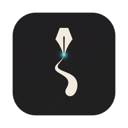

<p align="center"></p>

# Nib

**Turn an iPad and Apple Pencil into a pressure-sensitive drawing tablet for your Mac.**

Nib works like a Wacom Intuos: the iPad screen stays dark, the Pencil maps
absolutely onto a Mac display, and Mac drawing apps — Krita, Photoshop,
Affinity — receive real tablet events with **pressure and tilt**. Fingers
handle the canvas: scroll, pinch to zoom, twist to rotate, tap to undo.

> Status: early but usable daily. Built and tested on an iPad mini (A17 Pro)
> with Apple Pencil Pro and an Apple Silicon Mac. See [`PLAN.md`](PLAN.md).

## Features

- **Real tablet pressure and tilt** — injected as macOS tablet events, so apps
  treat Nib like a hardware tablet, not a mouse.
- **Screen-off drawing** — the iPad stays black (or faintly lit for edge
  buttons); you look at the Mac, not the iPad.
- **USB-C or Wi-Fi** — plug in for the lowest jitter; Nib switches to USB
  automatically and falls back to Wi-Fi when you unplug.
- **Trackpad-style gestures** — two-finger scroll, pinch to zoom and twist to
  rotate the canvas (sent as native macOS magnify/rotate gestures), two-finger
  tap to undo, three-finger tap to redo.
- **Shortcut buttons and a slide strip** — ExpressKeys-style buttons on one edge
  (tap or hold, e.g. hold Space to pan) and a strip on the other for scroll,
  zoom or brush size.
- **Per-app profiles** — the Mac reports the frontmost app and the iPad switches
  buttons and gestures to match. Presets for Krita, Photoshop and Affinity;
  edit everything on the iPad.
- **Pressure curve on the iPad** — soft/linear/firm presets, min/max
  thresholds, and a test strip that shows what the Mac receives.

## Requirements

- Mac with Apple Silicon, macOS 14 or later.
- iPad with Apple Pencil support (developed on iPad mini 6/7), iPadOS 18 or later.
- Xcode, [XcodeGen](https://github.com/yonaskolb/XcodeGen) (`brew install xcodegen`),
  and an Apple ID signed in to Xcode (a free account works for personal installs).

## Build and install

There are no prebuilt downloads yet; build both apps from source.

```bash
git clone <this repo> nib && cd nib
xcodegen generate
open Nib.xcodeproj
```

1. In Xcode, select each target (`NibMac`, `NibPad`) → **Signing & Capabilities**,
   choose your team. If signing complains about the bundle identifier, change
   `bundleIdPrefix` and the two `PRODUCT_BUNDLE_IDENTIFIER`s in `project.yml`
   to your own reverse-DNS prefix and run `xcodegen generate` again.
2. Run **NibMac** on the Mac. It lives in the menu bar (no Dock icon).
3. Connect the iPad, select it as the run destination, and run **NibPad**.
   The first time, trust the developer profile on the iPad
   (Settings → General → VPN & Device Management).

## First run

1. **Accessibility** — NibMac posts input events, so macOS asks for
   Accessibility permission. Grant it in System Settings → Privacy & Security →
   Accessibility, then **quit and reopen NibMac** (macOS only applies the grant
   to a fresh launch).
2. **Connect** — open Nib on the iPad. Over Wi-Fi, both devices must be on the
   same network; allow Local Network access when asked. Over USB-C, plug in and
   accept "Trust This Computer". The Mac asks once to **Allow** the iPad.
3. **Draw** — the menu shows `iPad · Connected via USB` (or `Wi-Fi`). Pick the
   target display in the menu if you have more than one; turn on
   **Show Diagnostics** to see sample rate, loss, jitter and latency.

## Using Nib

| On the iPad | On the Mac |
| --- | --- |
| Pencil | Tablet pen with pressure and tilt; double-tap / squeeze toggles eraser |
| Two-finger slide | Scroll / pan the canvas |
| Pinch / twist | Zoom / rotate the canvas |
| Two-finger tap / three-finger tap | Undo / redo |
| Edge buttons and strip | Keyboard shortcuts from the active profile |
| **Four-finger tap** | Opens the companion panel |

The **companion panel** holds the pressure curve, profiles (buttons, strip,
gesture options per app), edge-button brightness, and a debug HUD that shows
pressure, angles, sample rate and link state.

Each two-finger gesture decides once whether it is a scroll or a zoom/rotate,
so a twist does not turn into a scroll; a deliberate twist during a scroll still
switches to rotating.

## Troubleshooting

- **The cursor does not move** — Accessibility was probably granted while NibMac
  was running. Quit and reopen NibMac.
- **Stays on Wi-Fi with the cable plugged in** — bring Nib to the front on the
  iPad once (iPadOS closes its USB listener while suspended) and make sure the
  iPad trusts this Mac.
- **The Pencil stops for a few seconds every so often, in every app** — check
  Settings → Bluetooth. A Pencil that disconnects on a regular cycle (we saw
  every 30 s) is an iPadOS/Pencil pairing problem: forget the Pencil, restart the
  iPad, and pair again.
- **An app ignores pinch or rotate** — in that app's profile, set the zoom method
  to *Modifier + scroll*. Native gestures use undocumented macOS event fields
  (see [decision 0007](docs/decisions/0007-native-gesture-events.md)).
- Logs: `log stream --info --predicate 'subsystem == "dev.yukai.nib"'`.

## How it works

The iPad captures Pencil samples (position, force, altitude, azimuth) and sends
fixed 40-byte packets over UDP on Wi-Fi or a framed stream over USB (usbmuxd);
finger gestures, keys and settings-driven events travel on a reliable control
channel. NibMac maps samples onto the chosen display and posts CoreGraphics
tablet-proximity and tablet-point events. Details:
[`docs/architecture.md`](docs/architecture.md) and the decision records in
[`docs/decisions/`](docs/decisions/).

## Development

```bash
scripts/verify.sh                              # the gate: format, tests, both app builds
swift test --package-path Packages/NibCore     # unit tests only
swift run --package-path Packages/NibCore nib-inject-demo    # pressure stroke, no iPad needed
swift run --package-path Packages/NibCore nib-gesture-demo   # zoom/rotate the front app
```

Contributor and agent workflow: [`AGENTS.md`](AGENTS.md).

## Security note

Pairing is an Allow/Deny prompt remembered by device name; traffic is not yet
encrypted or authenticated. Use Nib on networks you trust (or over USB).
Pairing and encryption are planned (`PLAN.md`, M3).

## License

[MIT](LICENSE)
